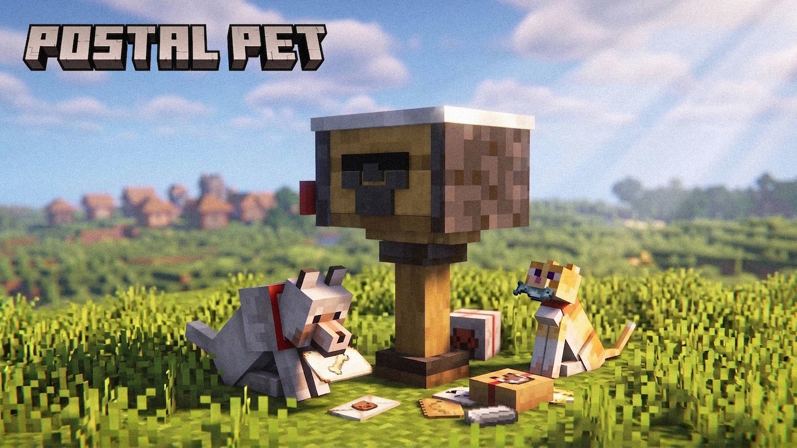
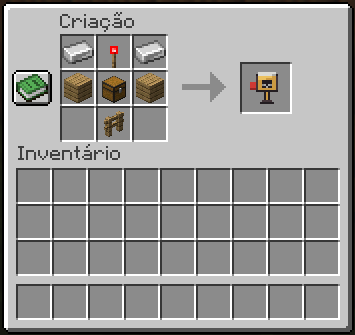
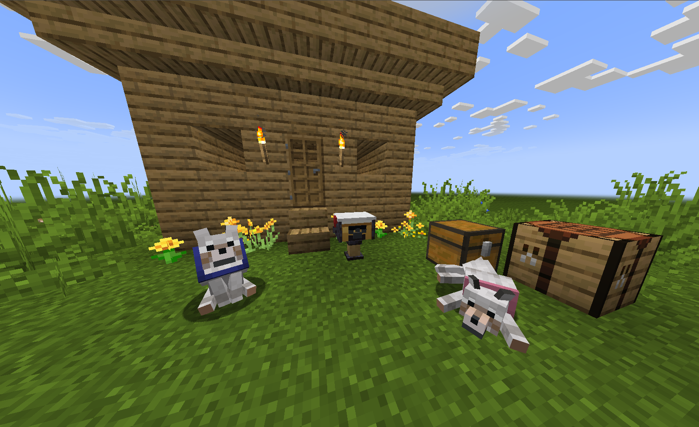
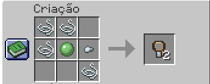
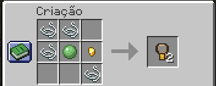
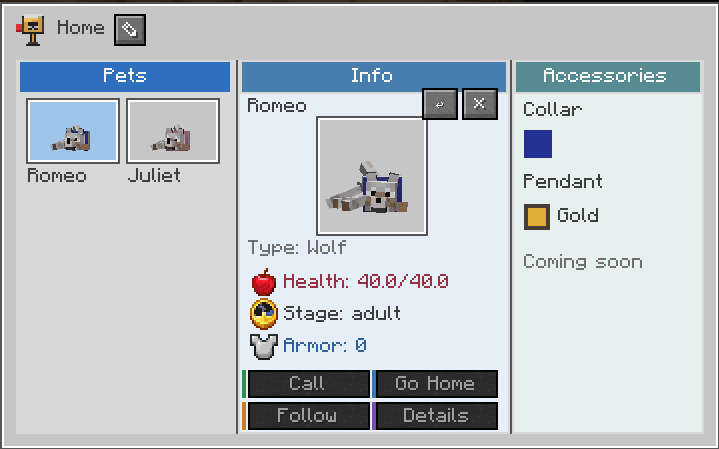
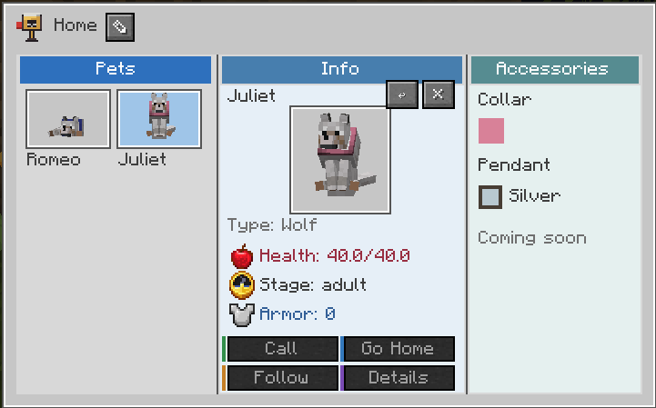
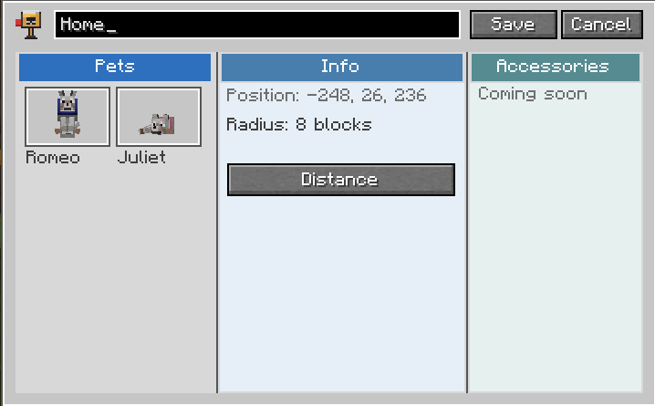
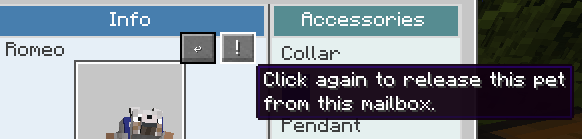

# Postal Pet

Arte promocional fornecida pelo mantenedor; as capturas do jogo aparecem abaixo.

[English](../../README.md) | [Português do Brasil](README.md) | [Español](../es/README.md)

Mod Fabric para caixas postais, vínculos e áreas de casa dos pets. Alvos beta: Minecraft 1.21/Java 21 e 26.2/Java 25. Baixe o JAR correspondente em [Releases](https://github.com/richardikeda/postal-pet/releases). Instale Fabric Loader 0.19.5 e Fabric API 0.102.0+1.21 (1.21) ou 0.160.0+26.2 (26.2). Use a mesma build do mod no cliente/servidor. Faça backup do mundo fechado antes de atualizar; esta é uma beta.

## Receita da Caixa Postal dos Pets

Duas barras de ferro, uma tocha de redstone, duas tábuas de carvalho, um baú e uma cerca de carvalho. A imagem mostra a interface em português; a receita funciona em todos os idiomas.

## Usar o mod

Ative a caixa com Shift + botão direito. Segure uma Guia de Prata ou Ouro na mão principal e clique com o botão direito em um pet seu domesticado, a até oito blocos. A caixa sua mais próxima do pet recebe o vínculo. Vincular consome uma guia em sobrevivência.

As guias produzem dois itens: linha superior Linha/Linha/Vazio; linha central Linha/Bola de slime/Pepita; linha inferior Vazio/Vazio/Linha. Use pepita de ferro para prata ou de ouro para ouro. A guia vanilla mantém o funcionamento normal.

Para desvincular, abra a caixa correspondente, selecione o pet, clique em × e confirme com !. Também é possível agachar e usar uma guia especial no pet perto da caixa vinculada. Desvincular não consome nem devolve guia. Para mudar de casa, desvincule e use outra guia perto do destino. Evite posições equidistantes entre caixas próximas.

O menu lista pets, edita o nome da caixa e alterna raios de 8, 16, 24 e 32 blocos. Comandos: /postalpet list, info, pets, show, radius, rename <nome>; aliases /pp e /petpost. Comandos de contexto usam sua caixa mais próxima dentro de oito blocos.

## Capturas do jogo

Romeo, Juliet e sua Caixa Postal dos Pets no mundo, sem shaders.

Receita da Guia de Prata (duas guias).

Receita da Guia de Ouro (duas guias).

Romeo selecionado: pingente de ouro e coleira azul.

Juliet selecionada: pingente de prata e coleira rosa.

Editando o nome da caixa para Home; raio de oito blocos.

Confirmação de desvínculo: clique novamente na exclamação.

[Roadmap](roadmap.md)

## Documentação

[Arquitetura](architecture.md) · [Contribuir](CONTRIBUTING.md) · [Testes](testing.md) · [Licenças](licenses.md)

Chamar/voltar/seguir e Habitats, Accessories, Care, Training e Field Guide estão planejados. Botões Em breve não executam essas ações.

Minecraft pertence aos respectivos titulares. Este projeto não é afiliado à Mojang ou Microsoft.

